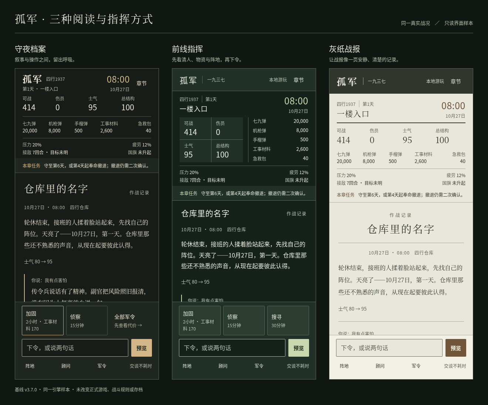

# 《孤军》三套UI预览

2026-11-15。用户已选择第一套“守夜档案”，v3.8.0已将其接入正式游戏，手机与桌面均保留单列叙事。正式交互、最新验证与发布结果见[UI-DESIGN.md](UI-DESIGN.md)和[HANDOFF.md](HANDOFF.md)。

下文为选择前的原型研究记录，基线为远端main `9d6a7fe`、v3.7.0。三份HTML仍是冻结快照与只读预览，不是可玩的游戏，也不作为v3.8.0的测试结果。

## 先看方案



| 方案 | 设计重点 | 实际取舍 | 预览源文件 |
|---|---|---|---|
| 守夜档案 | 时间、位置与章节合并到紧凑页眉；宋体叙事、旧铜色动作；正文与命令保持稳定关系 | 手机更平衡；短屏把快捷卡片收进“军令”，少用动作需多一步 | [交互预览](public/ui-concepts/night-archive.html) |
| 前线指挥 | 手机用2×2人物/状态仪表与物资账目并列；桌面分为阵地、战报、指挥三栏 | 桌面判断效率优先；390宽手机的叙事区域比另外两套小，信息密度更高 | [交互预览](public/ui-concepts/field-command.html) |
| 灰纸战报 | 暖灰纸面、居中战报标题与独立侧注；收敛快捷操作；正文高对比 | 适合作为白天阅读方向的备选；是否更舒适需真人长时阅读，不因浅色就保证护眼 | [交互预览](public/ui-concepts/paper-dispatch.html) |

原型阶段比较了上述三个方向。最终按用户选择采用守夜档案，不将前线指挥的三栏混入桌面；灰纸战报仍仅为备选原型。

## 当前UI复查

实际启动现有项目，以Chromium新建隔离浏览器上下文，进入四行1937序章。开始按钮固定、五项物资完整显示、文字与操作分工等既有改进有效；没有把旧v3.6的问题冒充当前问题。

| 当前发现 | 证据与影响 | 三套如何回应 |
|---|---|---|
| 320×640序章中控制区占比高 | 总览203.5px、地图入口45px、底部268px；作战记录容器123.5px | 紧凑层级、地图按需查看、短屏收起快捷卡片，保留输入和预览 |
| 重要敌情在手机顶部被省略 | 390截图的敌情句出现截断；title不能代替手机可见说明 | 接敌回合与“目标未明”持续可见，完整态势在阵地说明中读取 |
| 桌面仍按手机式纵向堆叠 | 1280×900中控件横向展开，作战记录容器397.5px | 三套分别探索单列叙事、三栏指挥、纸面与侧注 |
| 多行边界与重复时间/位置增加视觉重量 | 属设计判断，无玩家偏好统计 | 按任务分层与对齐，不用额外军械插画或持续特效堆气氛 |

同一序章状态的记录区域容器高度如下。容器包含标题与内边距，因此不能把数值直接称为净正文面积或阅读效率提升比例。

| 视口 | 当前正式版 | 守夜档案 | 前线指挥 | 灰纸战报 |
|---|---:|---:|---:|---:|
| 320×640 | 123.5px | 260.3px | 187.0px | 192.8px |
| 390×844 | 327.5px | 350.5px | 275.2px | 361.8px |
| 1280×900 | 397.5px | 504.5px | 613.1px | 503.7px |

前线指挥在390手机里主动用更多空间组织态势；这是取舍，不宣称三套在每个指标上都优于当前版本。

## Skill与参考如何使用

本次读并应用工作区的design-knowledge-retrieval、ui-design-director、ui-reference-research、ui-layout-typography、ui-color-materials、ui-mobile-cjk、ui-interaction-a11y和ui-design-review，以及项目war-ui-art-direction、mobile-game-ui、game-ui-verification。可切换的对话预览遵循visualize的UI方案规则。

设计资源库用于选择编辑式极简、理性网格、复古印刷和深色精密的组织原则，不把某资源站整站归成一种画风。字体与排印参考检索入口包括[Fonts In Use](https://fontsinuse.com/)，组件语义包括[The Component Gallery](https://component.gallery/)；本次没有重新声称已看过这些平台的全部作品。

已读的项目[UI-DESIGN.md](UI-DESIGN.md)保留有署名发行作品的来源与访问边界：[80 Days](https://www.inklestudios.com/80days/)、[This War of Mine](https://store.steampowered.com/app/282070/)、[Papers, Please](https://papersplea.se/)、[Roadwarden](https://store.steampowered.com/app/1155970/)。这次沿用其中阅读、文书秩序和低饱和层级原则，未重新逐页核验，也没有复制第三方图片、字体或资产。

专业判断顺序是：任务与事实 → 信息/交互结构 → 中文阅读与触控 → 视觉性格 → 性能与验证。审美选择没有可证明的90%正确率，适配理由、可测缺陷与待真人验证的偏好分开。

## 样本与安全边界

- 三套使用同一固定种子、同一引擎导出的状态和文字；提供序章与完成两步教学的样本，三章均能查看开场、任务、战术规则与军令代价。
- 快捷动作和输入只显示预览，不能执行军令、改变资源、推进时间或写入正式存档；不把预览说成可完整游玩的新版本。
- 军令代价来自现有getActionPreview；未知目标不绘制为敌军位置，样本数据也剔除了未侦察目标和战斗RNG状态。
- 未新加事件、撤退终章、付费服务、外部字体或AI请求。预览采用原创CSS与真实本方阵地数据，不伪造史料或历史人物内心。

## 本次实际验证

- `npm run check`：类型检查、442项测试、10,320组语言检查和生产构建通过。
- 30组布局：3方案×2样本×320×640、390×844、768×1024、1280×900、844×390五种尺寸。检查横向溢出、主要操作边界、44px目标、数据值和样本散列。
- 三套分别验证军令/输入预览、阵地、顾问只读、三章切换、战术规则、弹窗Escape、存档不变、叙事文字32px放大与输入转义。
- 已检查文本组合的最低对比4.744:1；这不是完整无障碍认证。模型请求0，页面脚本错误0。
- 浏览器尺寸模拟不是iOS/Android实机；200%检查只针对叙事正文，未完成全系统字体缩放、真实虚拟键盘、屏幕阅读器与长时玩家实验。
- 本阶段未修改规则、军令或存档实现，因此不将既往战役模拟数字当本次验证，也未为了纯预览重新声明模拟结果。

机器结果见[验证数据](design/ui-concepts/verification.json)，基线几何见[基线数据](design/ui-concepts/baseline-metrics.json)。代码完成、本地验证、分支推送、正式界面接入和线上部署分别记录；正式接入与部署需在选择方案后另做。

## 复现与文件

```sh
npx vite-node tools/exportUiConceptFixture.ts
python tools/buildUiConcepts.py
npm run dev -- --host 127.0.0.1 --port 3021
node tools/verifyUiConcepts.cjs
```

本地开发预览地址使用`/ui-concepts/index.html`；Vite不应只请求目录路径，以免回退到正式App。生成的4个HTML均自包含，可离线打开；预览不注册游戏Service Worker。校验工具使用环境已有的Playwright和Chromium，其他环境需自行准备，游戏运行不依赖它们。

buildUiConcepts默认把交付副本放到已忽略的test-artifacts/ui-concepts，可用`--artifacts`指定目录。验证可用UI_CONCEPT_URL、UI_CONCEPT_ARTIFACTS、UI_CONCEPT_CHROMIUM覆盖地址、证据目录和浏览器路径。
